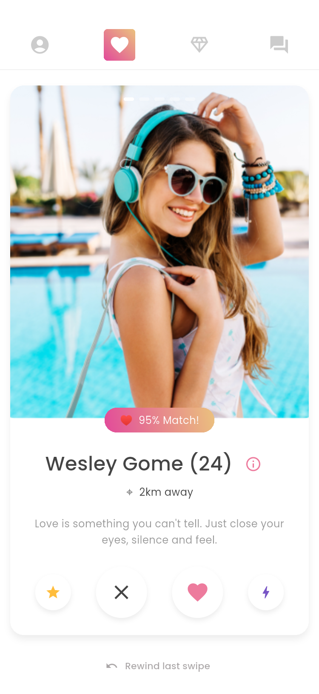
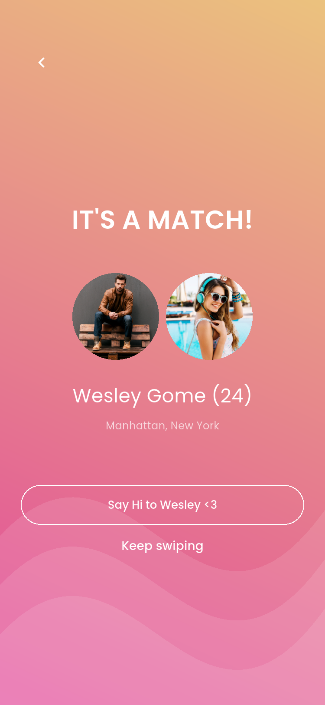
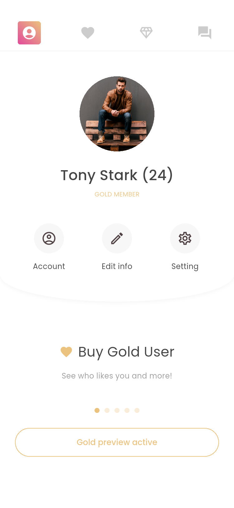
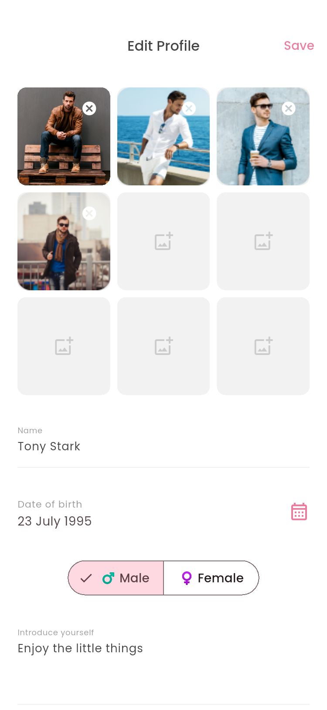

# Boobe · Flutter 交友应用

基于用户提供的 **Pixso / Boobe** 设计实现的可运行 Flutter 应用，保留白色背景、Poppins 字体、粉金渐变、卡片式人物资料及顶部四栏导航。界面文案沿用英文，本文档使用中文。

## 主要界面（应用运行截图）

以下图片来自已有 Android 11 模拟器的运行结果，非设计稿。更多状态见 [截图索引](docs/SCREENSHOTS.md)。

| 发现与滑卡 | 匹配成功 | 聊天 |
| --- | --- | --- |
|  |  |  |

| 会员精选 | 个人中心 | 编辑资料 |
| --- | --- | --- |
|  |  |  |

## 设计来源与覆盖范围

2026-11-08，通过 Pixso MCP 连接文件 `Boobe`，读取 `Page 1 (0:1)`。该文件只有一个 Page；页面内包含 **52 张宽度为 375 的手机画板**，以及独立的宣传、展示画板。手机画板逐张导出，未修改原设计文件。

- [设计画板清单](docs/design_inventory.json)：节点 ID、名称、尺寸。
- [设计与实现对照表](docs/DESIGN_COVERAGE.md)：52 张画板分别对应的应用入口及状态。
- `docs/design/`：MCP 导出的全部手机原稿；透明底保持原样，查看时请使用白色背景。
- `docs/screenshots/`：52 张应用实际运行截图及概览（50 张自动截图 + 启动和键盘原生截图）。
- `assets/images/`：通过 MCP 提取的人物照片、Logo、引导插画和封面，原图总计约 1.2 MB。

设计中的男女注册、长短详情、输入键盘、滑卡反馈、会员锁定与解锁等属于同一界面的状态，采用共享页面实现。手机系统状态栏、输入法和返回导航遵从 Android；图标采用 Flutter Material 图标。滑卡采用手势与按钮操作，超级喜欢采用反馈弹窗；音乐、支付、社交授权等服务交互为明确标注的本地演示，并非所有设计动效的逐帧复制。

## 已实现功能

| 模块 | 内容 |
| --- | --- |
| 启动和登录 | 启动页、两页引导、欢迎页、邮箱格式校验、本地演示登录、社交登录说明、找回密码说明 |
| 注册 | 开始、个人信息、生日日期选择（18 岁及以上）、性别切换、居住地、兴趣选择、账号及密码校验、完成 |
| 发现 | 人物卡片、左右快速滑动、跳过、撤回、喜欢与演示匹配、超级喜欢余量、附近搜索展示 |
| 资料 | 男女资料详情、可滚动个人介绍、音乐信息、照片网格、全屏照片与缩放 |
| 聊天 | 新匹配横向列表、会话列表、即时姓名搜索、空会话、文字/爱心/预置图片发送、会话静音、确认后删除匹配 |
| Gold | 喜欢我的人（模糊锁定/解锁）、精选人物、方案选择、账单展示、明确的模拟支付及本地解锁 |
| 个人中心 | 头像、资料入口、五页会员权益轮播及可点击指示点 |
| 编辑资料 | 姓名、生日、性别、介绍、电话、邮箱、学校、工作、居住地、兴趣、照片排序替换及保存、音乐选择与移除 |
| 设置 | 性别偏好、距离、年龄范围、展示开关、通知开关、退出登录、暂停展示、确认后清除本地账号 |
| 辅助页面 | 帮助、素材授权说明、演示条款及本地隐私说明 |

资料、照片选择、偏好、通知设置、音乐、聊天、静音和删除状态、Gold 演示状态保存在设备本地。重启后可读取。当前卡片位置、撤回历史、搜索文本及页面滚动位置属于临时界面状态。

## 项目结构与架构

```text
BoobeOnlineDatingSearchAndChatApplication/
├── lib/
│   ├── main.dart                       # 初始化 Flutter、读取本地数据
│   ├── app.dart                        # 主题、路由、顶部导航和主页面
│   ├── data/
│   │   ├── models.dart                  # 人物、音乐、消息模型和演示内容
│   │   └── local_store.dart             # SharedPreferences 本地 JSON 存储
│   ├── state/
│   │   └── app_state.dart               # 共享状态、消息、偏好、保存及清除账号
│   ├── ui/
│   │   └── design.dart                  # 色彩、背景、按钮、头像、表单等公共组件
│   └── features/
│       ├── auth/auth_screens.dart       # 启动、引导、登录和注册
│       ├── discover/discover_screens.dart # 发现、详情、匹配、图片和附近搜索
│       ├── chat/chat_screens.dart       # 消息列表、会话、会话选项
│       ├── gold/gold_screens.dart       # Gold 列表、方案弹层和支付演示
│       └── profile/profile_screens.dart # 个人中心、编辑、设置、音乐和账户
├── assets/
│   ├── images/                         # 设计原始素材
│   └── fonts/                          # Poppins 字体及 OFL 授权
├── android/                            # Android 宿主工程及品牌启动图标
├── test/widget_test.dart               # 本地状态、页面布局、聊天和编辑测试
├── integration_test/app_flow_test.dart # 模拟器完整旅程及自动截图
├── test_driver/integration_test.dart   # 将模拟器截图写入文档目录
├── docs/                               # 设计对照、测试记录和截图
└── dist/                               # 最终 Android 演示安装包
```

数据流为：`界面操作 → AppState → 通知组件刷新 → LocalStore → 设备本地存储`。`AppScope` 使用 Flutter 自带 `InheritedNotifier` 注入 `ChangeNotifier`；不引入额外状态管理或路由框架。每个功能文件集中管理该功能的页面，重复样式集中在 `ui/design.dart`。

本地存储采用一个版本化记录 `boobe.v1`，保存时按顺序写入，避免连续输入导致较早的数据覆盖较新的数据。密码仅作表单校验，既不保存也不发送；支付页面使用固定示例值，不接收银行卡输入。

## 运行

本机已安装 Flutter **3.47.7 / Dart 3.13.5**。工程仅生成 Android 平台，避免无关平台目录。业务 Dart 代码未依赖 Android 专属接口，需要其他平台时可按 Flutter 标准方式补充宿主并单独验证；本次仅验证 Android。

```powershell
flutter pub get
flutter run -d emulator-5554
```

首次运行可浏览引导，选择 `Login by mail`，使用任意格式有效的邮箱及至少 6 个字符的密码。也可使用 Facebook/Google 按钮进入本地演示账号。它们不会访问外部账号。

安装 `dist` 中的 APK 也可直接体验。该安装包为 **Android x86_64 模拟器版本**，并使用开发签名；实体 ARM 手机请从源码构建：

```powershell
flutter build apk --release --target-platform android-arm64 --split-per-abi
```

Android 构建使用已缓存的 Gradle 8.14、AGP 8.11.1、Kotlin 2.2.20 和 Java 17 目标，避免初始 AGP 9 模板在本机出现的 DSL 编译错误。构建需要安装对应 Android SDK 并接受其许可。

## 验证与重新生成截图

```powershell
flutter analyze
flutter test
flutter drive --driver=test_driver/integration_test.dart --target=integration_test/app_flow_test.dart -d emulator-5554
```

详见 [测试记录](docs/TESTING.md)。自动截图测试使用固定演示内容并写入被测试应用的本地数据，适合开发模拟器；重复运行会重置这一组演示状态。

## 演示边界

这是按设计开发的离线 UI 原型。没有接入真实身份认证、服务器、实时聊天、定位、推荐算法、推送、音乐播放、Instagram/Facebook/Google 授权或支付订阅。设置保存的是本地偏好，人物列表使用固定演示数据，不代表真实附近用户或实时匹配；喜欢操作进入演示匹配。图片选择器使用已有设计素材，不读取设备相册。

正式发布需要接入上述服务、补充服务条款及隐私政策、确认设计图片的商用授权，并使用正式签名。本地草稿不应存放真实敏感资料。

## 精简与资源使用

运行依赖仅 Flutter 与 `shared_preferences`。字体及图片均本地打包，运行不下载素材。不创建新模拟器，不下载其他系统镜像。交付时保留源代码、文档、全部界面截图和一份安装包；已移除约 1.5 GB 临时构建文件与重复输出，仍有约 1 MB 构建文件被进程占用，详见测试记录。项目总占用约 53 MB；全局 Flutter、Gradle、Android SDK 缓存和已有模拟器均保留。
