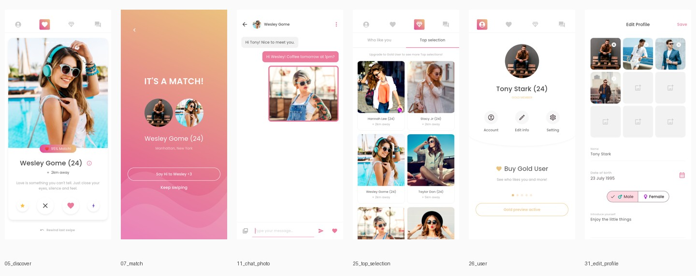
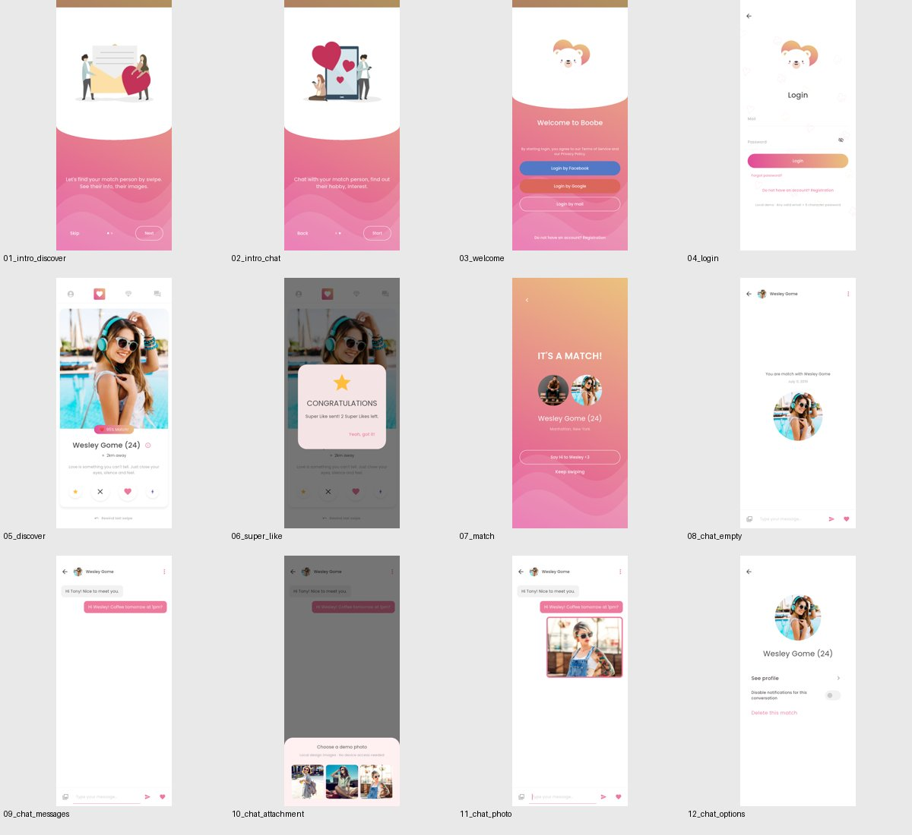
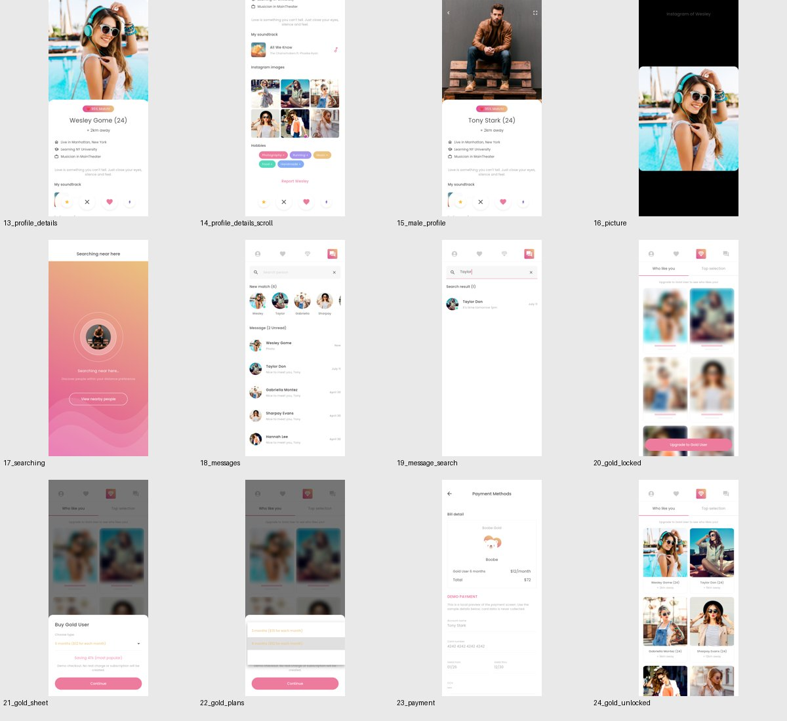
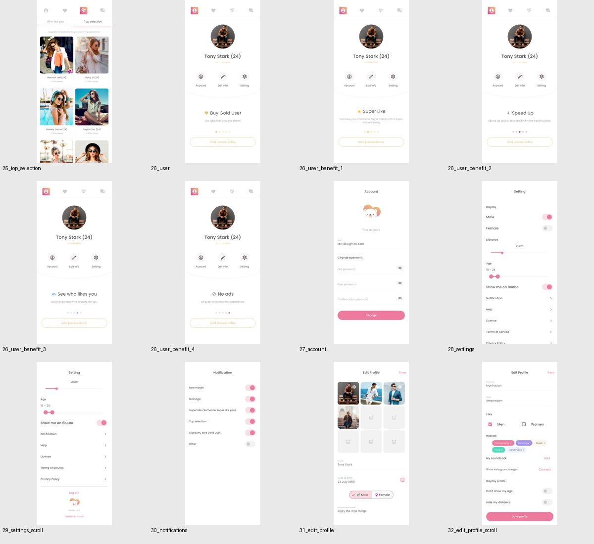
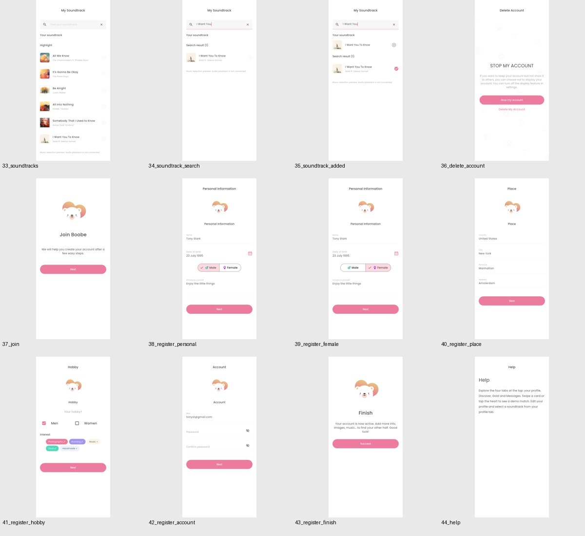
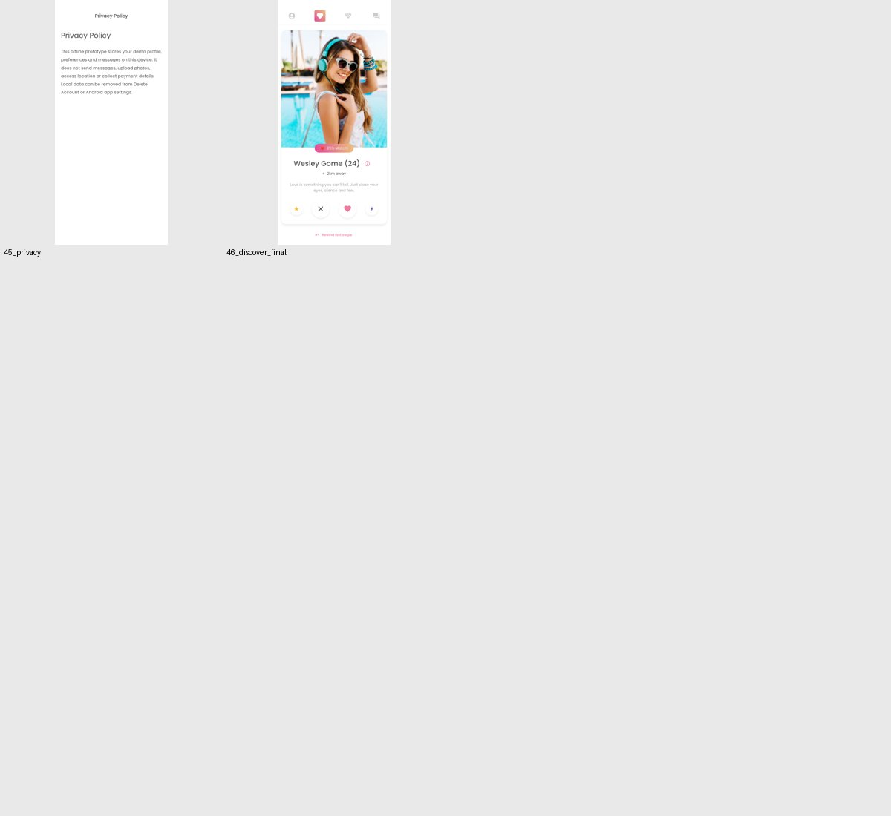

# 应用截图索引

这些图片为模拟器上实际运行的 Flutter 界面；`design/` 目录保存 Pixso 原稿。集成测试截图只包含 Flutter 绘制区域，原生截图包含状态栏及系统输入法。

## 主要界面概览

## 全部运行状态

| 图片 | 界面 |
| --- | --- |
| [01_intro_discover](screenshots/01_intro_discover.png) | 引导：发现 |
| [02_intro_chat](screenshots/02_intro_chat.png) | 引导：聊天 |
| [03_welcome](screenshots/03_welcome.png) | 欢迎和登录方式 |
| [04_login](screenshots/04_login.png) | 邮箱登录 |
| [05_discover](screenshots/05_discover.png) | 发现首页 |
| [06_super_like](screenshots/06_super_like.png) | 超级喜欢反馈 |
| [07_match](screenshots/07_match.png) | 匹配成功 |
| [08_chat_empty](screenshots/08_chat_empty.png) | 空会话 |
| [09_chat_messages](screenshots/09_chat_messages.png) | 文字会话 |
| [10_chat_attachment](screenshots/10_chat_attachment.png) | 选择图片 |
| [11_chat_photo](screenshots/11_chat_photo.png) | 图片会话 |
| [12_chat_options](screenshots/12_chat_options.png) | 会话选项 |
| [13_profile_details](screenshots/13_profile_details.png) | 资料首屏 |
| [14_profile_details_scroll](screenshots/14_profile_details_scroll.png) | 资料滚动内容 |
| [15_male_profile](screenshots/15_male_profile.png) | 男性资料 |
| [16_picture](screenshots/16_picture.png) | 全屏照片 |
| [17_searching](screenshots/17_searching.png) | 附近搜索 |
| [18_messages](screenshots/18_messages.png) | 消息列表 |
| [19_message_search](screenshots/19_message_search.png) | 会话搜索 |
| [20_gold_locked](screenshots/20_gold_locked.png) | Gold 锁定 |
| [21_gold_sheet](screenshots/21_gold_sheet.png) | 购买会员弹层 |
| [22_gold_plans](screenshots/22_gold_plans.png) | 选择会员方案 |
| [23_payment](screenshots/23_payment.png) | 模拟支付 |
| [24_gold_unlocked](screenshots/24_gold_unlocked.png) | Gold 解锁 |
| [25_top_selection](screenshots/25_top_selection.png) | 精选人物 |
| [26_user](screenshots/26_user.png) | 个人中心 |
| [26_user_benefit_1](screenshots/26_user_benefit_1.png) | 个人中心权益轮播 |
| [26_user_benefit_2](screenshots/26_user_benefit_2.png) | 个人中心权益轮播 |
| [26_user_benefit_3](screenshots/26_user_benefit_3.png) | 个人中心权益轮播 |
| [26_user_benefit_4](screenshots/26_user_benefit_4.png) | 个人中心权益轮播 |
| [27_account](screenshots/27_account.png) | 账号 |
| [28_settings](screenshots/28_settings.png) | 设置首屏 |
| [29_settings_scroll](screenshots/29_settings_scroll.png) | 设置滚动内容 |
| [30_notifications](screenshots/30_notifications.png) | 通知设置 |
| [31_edit_profile](screenshots/31_edit_profile.png) | 编辑资料首屏 |
| [32_edit_profile_scroll](screenshots/32_edit_profile_scroll.png) | 编辑资料滚动内容 |
| [33_soundtracks](screenshots/33_soundtracks.png) | 音乐列表 |
| [34_soundtrack_search](screenshots/34_soundtrack_search.png) | 音乐搜索 |
| [35_soundtrack_added](screenshots/35_soundtrack_added.png) | 已选音乐 |
| [36_delete_account](screenshots/36_delete_account.png) | 暂停和删除账号 |
| [37_join](screenshots/37_join.png) | 注册开始 |
| [38_register_personal](screenshots/38_register_personal.png) | 个人信息 |
| [39_register_female](screenshots/39_register_female.png) | 女性注册 |
| [40_register_place](screenshots/40_register_place.png) | 居住地 |
| [41_register_hobby](screenshots/41_register_hobby.png) | 兴趣 |
| [42_register_account](screenshots/42_register_account.png) | 注册账号 |
| [43_register_finish](screenshots/43_register_finish.png) | 注册完成 |
| [44_help](screenshots/44_help.png) | 帮助 |
| [45_privacy](screenshots/45_privacy.png) | 隐私说明 |
| [46_discover_final](screenshots/46_discover_final.png) | 流程完成后发现页 |
| [47_splash_native](screenshots/47_splash_native.png) | 发布安装包启动页（原生截图） |
| [48_chat_keyboard_native](screenshots/48_chat_keyboard_native.png) | 发布安装包系统键盘及输入自适应（原生截图） |

## 分组概览

